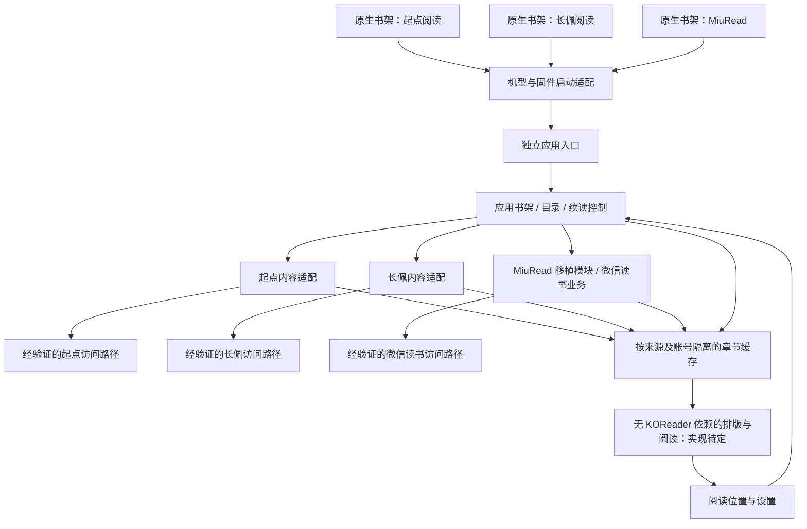

# Kindle 阅读应用：起点、长佩与 MiuRead 的需求及技术设计

- 日期：2026-10-27
- 状态：设计修订稿；起点、长佩和 MiuRead 均需原生书架直达且不依赖 KOReader；MiuRead 独立化及具体技术选型待验证，未进行产品实现。
- 项目：`kindle-read`
- 配套文档：[可行性验证](../../feasibility.md) · [里程碑与验收](../../roadmap.md)

## 1. 项目意图

让已越狱 Kindle 可以方便地使用起点阅读、长佩阅读和 MiuRead。原生书架显示三个应用入口，点击即可进入各自阅读流程；MiuRead 保留其微信读书用途。日常使用不需要连接电脑、转换文件或逐层寻找插件菜单。

项目的价值在于把“找到小说、继续阅读、查看更新”变成适合墨水屏的短流程，同时保留 Kindle 的分页、中文排版和休眠续读体验。

### 1.1 已明确的需求

| 编号 | 用户要求 | 成功的含义 |
| --- | --- | --- |
| U1 | 面向越狱版 Kindle | 应用在真实越狱 Kindle 上运行；电脑演示只能辅助开发 |
| U2 | 能阅读起点小说 | 使用真实的起点内容路径完成阅读；仅能打开本地 TXT/EPUB 不足以证明 |
| U3 | 像书架中的 app，点开就能看 | 原生书架存在项目入口；点击后直达项目界面或续读正文 |
| U4 | 先做项目文档 | 本阶段交付需求、技术选择依据、验证计划和验收标准 |
| U5 | 在 Vera 越狱的 Kindle 上独立运行，不依赖 KOReader | 三个应用的安装包和运行过程均不要求或捆绑 KOReader |
| U6 | 也开发长佩阅读功能 | 独立验证长佩真实内容、账号和权限；不能仅把起点应用改名 |
| U7 | MiuRead 本身也要原生书架入口，点击即用 | 独立化 MiuRead 并保留微信读书阅读用途；不是仅参考界面、换名或打开 KOReader 插件菜单 |

这里将“书架”解释为 Kindle 原生书架，而非阅读器内部文件列表。这是对用户意图的解释，后续若有纠正应同步修改 U3。

用户已更正设备信息：**KPW5（Kindle Paperwhite 5），使用 Vera 越狱**。尚未实机检查；此前“已安装 KUAL”的记录已撤回，不据越狱方式推断固件版本或启动器安装状态。KOReader 不再是本项目依赖，也无需以其安装状态作为开发前提。

用户已确认所指为 `miumiupy98-art/miuread-koreader`，并进一步纠正：MiuRead 不仅是交互参考，本身也应从原生书架点击即用。此前将它缩为参考的解释已撤回。其 KOReader 依赖已有资料证据，因此本项目增加 MiuRead 独立化工作线，并保留起点、长佩工作线；新增微信读书用途不替换其他来源。详见 [MiuRead 独立化方案](../../miuread-porting.md) 与 [证据及验证项](../../feasibility.md)。

### 1.2 初稿采用的默认建议

以下均为作者建议，不代表用户已作选择。

- 第一轮以用户的 KPW5 为验证设备，补齐其完整固件版本后固定测试组合，再决定扩展范围。
- 首次打开进入应用内书架；再次打开优先续读最近一本书的最近位置，并提供返回书架入口。
- 优先设备直连，第一版不要求用户另行维护电脑、手机常驻程序或服务器。
- 采用独立运行方向：起点、长佩内容适配与 MiuRead 独立化共同评估可复用的核心；MiuRead 业务逻辑优先在依赖审计后迁移，不能默认只模仿界面。具体组件在最小技术验证后确定。
- 起点和长佩分别用免费章节验证整条链路。两者的登录和已购章节均为独立关键验证项，不因为未完成而默认从用户目标中删除。
- 界面为简体中文；墨水屏优先，分页导航，不依赖动画或连续滚动。
- 暂不包含三个来源的站内购买流程。需要购买时由用户在对应官方渠道完成，项目不自动订阅、开通试用或扣费。

### 1.3 待确认的信息

| 信息 | 影响 | 当前处理 |
| --- | --- | --- |
| 完整固件版本 | 启动机制、运行时架构、可用独立应用组件 | 型号已确认为 KPW5；固件仍是实机验证前置条件，尚无通过测试的支持组合 |
| Vera 版本与可用启动方式 | 安装路径、已有依赖、入口适配 | 越狱方式已确认为 Vera；具体版本和可用启动方式待检查，不默认需要 KUAL |
| 首版各来源的付费、会员及已购支持范围 | 内容访问门槛、登录流程、发布范围 | 起点、长佩和微信读书分别记录，不假设三者权益模型相同 |

### 1.4 三个原生书架应用的范围

起点阅读、长佩阅读和 MiuRead 都是交付目标。MiuRead 的内容来源为微信读书，与另外两个来源分别处理。产品组织如下：

- 原生书架分别显示「起点阅读」「长佩阅读」「MiuRead」，每个入口直接打开自己的最近正文、书架或首次登录流程，不能先进入统一的二级应用选择菜单。
- 优先评估共用启动适配、排版与设备管理；MiuRead 移植模块独立标识。能否共享具体代码取决于接口、版本与许可，不为了共用强行改写整个上游。
- 三个来源的书籍标识、账号会话、权限、缓存和进度相互隔离；不假设同名作品、会员或已购权益通用。
- 每个平台各自验证免费正文、登录、付费内容、缓存许可和更新；一个平台通过不能代表另一个通过。
- 无 KOReader 依赖的约束同时适用；先解决公共运行基础，再分别实现内容适配，不能把新增入口当作简单换名称。

三个入口可由共用程序携带应用标识启动，也可分包；MiuRead 可使用单独移植包。具体打包由验证及许可核对决定。安装、升级和卸载任一入口不能破坏另外两个；共享核心只有在没有其他入口依赖时才可移除。

MiuRead 的首个可验收闭环为：原生入口、微信读书授权、账号书架、选择并获取有权访问的正文、阅读与本地续读、正常退出。云端进度、批注、阅读时长、翻译等现有上游功能须形成逐项迁移表；不能默认删掉后宣称已完整移植。首轮闭环与完整功能迁移是不同的交付状态，详见独立化方案。

## 2. 范围与优先级

### 2.1 必须保留的体验

1. **入口**：系统书架有可辨识的项目项，单击直接进入项目；若设备已有 KUAL，其菜单仅可用于调试或故障恢复，不是最终入口。
2. **找书**：起点、长佩先支持对应书籍链接/ID；MiuRead 首轮保留微信读书授权和账号书架选书流程，不把它改成只能手工输入 ID 的通用阅读器。各入口拒绝误投其他来源的链接。
3. **阅读**：目录选章、上一页/下一页、上一章/下一章、字号与行距设置；已缓存内容可离线阅读。
4. **续读**：保存书籍、章节及章节内位置；退出、休眠和正常重启后可恢复。
5. **更新**：用户主动检查目录更新；在内容访问方式允许时，按需加载与少量预取后续章节。
6. **可恢复**：网络断开、登录过期、权限不足、缓存损坏时保留当前位置，给出明确的下一步操作。
7. **可安装与卸载**：提供按已验证机型编写的说明，保留用户已有应用和书籍，能够移除项目入口及组件；安装器不安装或下载 KOReader。

### 2.2 分阶段能力

| 优先级 | 能力 | 说明 |
| --- | --- | --- |
| P0 | 三个原生入口直达、各来源真实正文、基础阅读与续读 | MiuRead 额外完成脱离 KOReader 后的授权、账号书架与正文获取闭环 |
| P0 验证项 | 登录后已购章节访问 | 发布是否必需取决于用户目标；可行性必须尽早查明 |
| P1 | 应用内多书管理、目录更新、缓存管理、阅读设置 | 面向日常使用的首版范围 |
| P2 | 起点/长佩关键词搜索、账号书架及多设备同步 | 不承诺已有接口；MiuRead 已有功能按专门迁移表管理，不一律降为 P2 |
| 起点/长佩暂不做 | 评论、打赏、榜单、推荐流、有声书、漫画、站内支付 | 限于这两个新增接入；MiuRead 现有功能按专项迁移表逐项处理，不据此默认删减 |

### 2.3 明确不算成功的结果

- 安装包存在但没有在真实 Kindle 上启动。
- 原生书架入口只打开通用启动菜单或文件管理器，还需要用户继续找阅读入口。
- 把 KOReader 藏在 MiuRead 后台或包内，声称“不依赖 KOReader”。
- 将微信读书接入当成起点接入，或用同名项目的宣传代替依赖核实。
- 仅新增一个名为 MiuRead 的入口，却没有可用的微信读书功能；或将 MiuRead 再次缩为交互参考。
- 每次阅读都要求手动下载、转换和传输文件。
- 用模拟章节、第三方小说站内容或本地导入证明“已支持起点/长佩”。
- 免费章节可读就宣称所有 VIP、订阅和账号功能可用。
- 用持续后台联网或阻止休眠来维持阅读进度。

## 3. 典型使用流程

### 3.1 首次使用

1. 用户按目标设备说明安装必要依赖及项目包。
2. 安装对应应用后，原生书架出现起点、长佩或 MiuRead 项目项；全部安装时三项并存。
3. 起点、长佩首次进入对应空书架；MiuRead 首次进入授权/账号书架流程，已登录时不重复要求登录。
4. 起点、长佩输入书籍链接或 ID；MiuRead 从账号书架选择书籍。应用按对应来源获取目录与正文。
5. 点击可阅读章节，进入正文。权限受限章节显示对应状态，不把错误页当作正文。

安装过程中允许一次性配置依赖，但日常阅读应遵守单击入口的要求。书架显示是否依赖系统注册、索引或筛选条件，必须写入目标机型验证记录。

### 3.2 日常续读

1. 从原生书架点击项目入口。
2. 有当前平台的有效阅读记录时直接显示最近位置；无记录时显示该平台的应用内书架，不跳转另一平台最近读的书。
3. 默认优先使用缓存，联网检查不阻塞已有正文。
4. 用户可打开目录、回应用书架或退出到 Kindle。
5. 离开正文、切章、进入休眠或退出时保存位置；异常终止的丢失范围见验收指标。

### 3.3 登录与已购章节

登录方式尚未确定，不能预先承诺扫码登录、手机授权或 Cookie 导入可用。

- 若存在可用且允许第三方使用的授权方式，优先使用；按真实能力设计登录与会话续期。
- 若只能在官方网页完成交互，验证 Kindle 浏览器是否支持所需 JavaScript、验证流程和章节渲染。
- 在手机完成购买或登录，不等于 Kindle 应用自动获得会话和正文访问权限；必须分别验证三个来源的会话承接方式。上游 MiuRead 有授权流程资料，但移植后仍需重新验证。
- 成功登录后仍逐章检查访问结果，区分已购、未购、试读、内容下架和平台限制。
- 无可用访问路径时按平台记录阻塞，不用其他来源补齐正文。若要发布免费章节版本，需明确缩小范围；一个平台成功不解除另一个的阻塞。

### 3.4 异常状态

| 状态 | 用户能看到什么 | 处理原则 |
| --- | --- | --- |
| 未联网 | 已缓存的正文，及「联网后加载本章」 | 不清空正文或进度，不自动反复联网 |
| 登录过期 | 「登录已过期」及可用的重新登录入口 | 不循环重试，不误报为作品不存在 |
| 章节未购买 | 「此章节需要在官方渠道购买」 | 不触发购买，不展示截断内容为完整正文 |
| 内容获取方式变更 | 「暂时无法加载」，可重试或继续缓存阅读 | 保留数据，记录无敏感信息的错误类别 |
| 空间不足 | 缓存空间提示及清理入口 | 不删除书架和进度；不把写了一半的文件当成成功缓存 |
| 启动依赖缺失 | 显示缺失组件或返回系统的提示 | 保证 Kindle 系统仍可操作；不反复重启应用，不自动安装 KOReader |

## 4. 技术方案比较

| 方案 | 组成 | 优点 | 主要代价与未知项 | 当前判断 |
| --- | --- | --- | --- | --- |
| A：独立核心 + MiuRead 专门移植 | 三个入口；独立排版与设备适配；起点/长佩接入；MiuRead 微信读书业务迁移 | 同时保留三个应用目标，移植边界可分开验证 | 需审计全部宿主依赖、替换接口、维护功能对照及许可 | 当前建议，先验证 MiuRead 最小独立闭环与公共核心 |
| B：以 MiuRead 独立分支为基础扩展 | 先完成 MiuRead 脱离 KOReader，再加入起点/长佩适配 | 可能更多保留其现有界面与业务 | 上游耦合会影响整个项目；是否适合统一核心需审计 | 可比较的实现路线，不假定一定优于 A |
| C：公开 miuread-koreader 插件或旧 KOReader 方案 | KOReader + 插件 | 已有微信读书相关实现 | 明确依赖 KOReader；微信读书能力不能推导为起点能力 | 不符合 U5，已排除 |

不优先采用常驻中转服务器：会引入额外安装、运行成本和会话保管，也不自动解决平台访问限制。如直接访问失败，先说明具体阻塞，再决定是否扩大部署范围。

### 4.1 开始实现的门槛

- MiuRead 身份与交付目标已明确；先审计其宿主依赖并验证替换接口，不能把现有插件当成已独立的引擎。独立应用同时验证排版、输入和墨水屏组件。
- 在没有安装 KOReader 的测试环境中，证明“原生书架 → 项目界面/最近正文”的完整链路；不能从用户日常设备移除已有软件来制造该环境。
- 起点、长佩与微信读书分别完成真实正文验证；MiuRead 的微信读书登录、会员、书架和下载能力须在移植后重验，不能视为起点或长佩能力。
- 若目标固件没有可用的原生书架入口，本轮 U3 未实现。需讨论可接受的调整，不能把多级菜单当成原需求完成。

## 5. 建议架构

以下是独立应用及 MiuRead 移植模块的逻辑职责。可在许可允许并完成依赖拆分后复用 MiuRead 业务代码，但不得调用 KOReader 运行时。具体实现语言和组件版本由 P0 验证选定。

### 5.1 组件职责

| 组件 | 职责 | 验证重点 |
| --- | --- | --- |
| 启动适配 | 注册/安装书架入口；启动应用；传递一次性启动意图；退出恢复系统 | 原生入口可见且可点击；不启动 KOReader；重复点击不产生重复阅读进程；可撤销安装 |
| 应用入口 | 按应用标识进入对应书架或续读；处理已有阅读进程 | 启动独立实现或移植后的 MiuRead；切换先保存旧进度，不加载上游未替换的 KOReader 依赖 |
| 应用界面 | 本地书架、目录、添加书籍、阅读设置和明确的错误提示 | 触控区域、物理按键、分页列表、灰度可读性 |
| 内容适配 | 起点、长佩分别实现；MiuRead 迁移其微信读书业务并适配独立核心 | 不跨来源复用凭据；不把登录页、验证码、试读片段或结构变化当成完整正文 |
| MiuRead 移植适配 | 替换上游对 UI、事件、设备、排版及存储的宿主调用 | 真实依赖审计、固定上游版本、功能对照与数据兼容；不止替换启动脚本 |
| 缓存 | 保存成功获取且允许缓存的章节；校验版本；控制空间；失败恢复 | 临时写入后原子替换；中断不污染旧内容 |
| 阅读组件 | 使用已验证、无 KOReader 依赖的排版能力显示章节，维护跨章导航和稳定位置 | 可用引擎和接口待确定；不暴露中间文件管理器；更新书籍不重置进度 |
| 会话管理 | 管理经过验证的登录状态及过期处理 | 不记录凭据、不把账号相关数据共享给其他会话 |

不得把启动脚本假装成普通 EPUB 并假定 Kindle 会执行它。原生入口的可用机制应针对 Vera、KPW5 及目标固件验证；不默认需要 KUAL，也不默认 Vera 已提供书架注册 API。KPM 的安装、启动、卸载钩子是已查到的调查方向，实际 scriptlet 注册和固件兼容性仍需验证。

### 5.2 内容适配契约

这些是项目内部的概念接口，不是声称各平台提供的公开 API。起点、长佩、MiuRead/微信读书各有适配边界；入口决定来源，不跨平台复用会话或把同一个接口地址换域名。MiuRead 账号书架和其他已有业务接口单独按迁移表保留。

| 操作 | 输入 | 结果 |
| --- | --- | --- |
| 获取能力 | 当前访问方式/会话 | 是否支持免费正文、登录、已购正文、缓存、书架同步等 |
| 获取书籍 | 来源 + 经校验的对应平台 URL 或书籍 ID | 书名、作者、稳定来源标识、来源链接 |
| 获取目录 | 来源书籍 ID、已知目录版本 | 有序章节列表；可见的权限信息；更新时间或本地获取时间 |
| 获取章节 | 书籍 ID、章节 ID、当前会话 | 完整性已检查的正文与版本，或明确的失败状态 |

统一失败类别至少区分：离线/超时、需要登录、需要购买、来源不支持、访问挑战、频率限制、内容不存在、结构解析失败。缺少公开接口并不自动证明项目不可行，但也不能凭空编造接口地址。

各平台书籍链接只用于识别该平台作品；拒绝其他来源、任意域名和本地文件路径。跨域重定向需要按已验证来源处理，不能携带会话凭据跳转至未知站点。

### 5.3 内容与位置存储

初稿建议使用 UTF-8 的版本化结构化元数据及独立章节文件；具体持久化库待运行时确定后选择，不预先引入新数据库依赖。

| 数据 | 最小字段/语义 |
| --- | --- |
| 书架项 | 来源、书籍 ID、书名、作者、加入时间、最近打开时间、来源链接 |
| 目录项 | 章节 ID、标题、顺序、可用权限状态、目录版本 |
| 章节缓存 | 来源/账号作用域、书籍 ID、章节 ID、内容版本/校验值、获取时间、缓存许可状态 |
| 阅读位置 | 来源、书籍 ID、章节 ID、内容版本、稳定段落锚点或阅读组件位置、更新时间 |
| 设置 | 字号、行距、边距、全刷偏好、缓存上限、启动时是否续读 |

位置不能只保存页码：字号、屏幕尺寸和内容变化都会改变分页。候选做法是“稳定章节 ID + 段落锚点 + 章节内偏移”；若正文版本变化无法精确恢复，则回退至最近可定位段落并说明，最差回到该章开头。需要验证与选定阅读组件位置表示的转换。

先查明选定排版组件实际支持的输入格式，再选择正文交付方式；HTML、EPUB 或直接段落数据都只是候选，不从 KOReader 的格式支持推导独立应用的能力。不默认每次更新就重建整本小说。所有持久化标识包含来源作用域，目录还需归属于对应书籍，防止三个来源的 ID 冲突。MiuRead 的账号标识和进度坐标需单独迁移，不能直接套用另两个平台的字段。

### 5.4 缓存、联网与会话

- 前台按需获取，初始建议预取接下来的 2 章；默认不在休眠时联网，不做无人值守全书下载。
- 请求数、超时、重试及退避应受控；访问挑战、权限错误不做自动重试，限流响应尊重服务端等待要求。
- 建议初始缓存上限为 100 MiB，可调整；清理最久未读内容时保护当前章节和阅读记录。参数为待实测默认值。
- 每章先写临时文件，完成正文检查及校验后再更新索引。目录变化不能删除正在阅读的有效缓存。
- 已购正文只有在经验证的访问方式允许获取及缓存时才纳入缓存范围；无法支持离线时明确显示能力限制。
- 账号切换隔离私有缓存；退出账号清理其会话与私有正文，保留不含凭据的本地进度时应向用户说明。
- 默认不长期存储登录会话，设备重启后可要求重新登录。若要支持持久登录，须先验证目标系统的受保护存储；`/mnt/us` 是 USB 可见存储，不能把设置 `chmod 600` 当作可靠保护。不得在代码、示例配置或日志中写入真实密码、Cookie 或 Token。
- 正文数据与项目设置可以考虑放在项目专属可写目录；最终路径、文件系统及卸载范围必须在实机验证后记录。项目不能覆盖已有应用设置或系统数据库。

### 5.5 设备生命周期与安装

- 明确独立应用由哪些组件负责输入、刷新、休眠、恢复和退出，补充技术设计及真机验证；这些能力不能再依赖 KOReader。
- 处理启动中再次点击、已有阅读进程、USB 存储模式、低电量、休眠唤醒、无 Wi-Fi 与组件更新。
- 若使用一次性启动标记，需限制有效期、成功消费后清理，并避免其他应用启动误读该标记。具体机制先做验证。
- 安装前检查机型、固件和依赖版本；不支持的组合应拒绝安装并说明原因。
- 项目代码、启动适配与用户数据分开；卸载可选择保留阅读记录；必须验证安装失败时的恢复路径。
- MiuRead 是拟移植组件；实施前固定上游版本，核对 AGPL-3.0-only、NOTICE、第三方依赖及与共用核心的许可兼容，保留修改记录并提供相应源码。具体分包和命名待审计，本阶段不复制上游实现。

## 6. 性能与质量目标

以下都是建议验收目标，不是实测结果。需要在确定的目标机型上记录固件、应用与运行时版本、内容规模与测试条件。

| 项目 | 建议目标 | 测量方式 |
| --- | --- | --- |
| 缓存续读冷启动 | 10 次中至少 9 次在 10 秒内显示可读正文 | 应用未运行，从点击书架项目到正文可读，记录全部耗时 |
| 已缓存页面翻页 | 30 次普通翻页的 P95 不超过 1 秒 | 固定小说和字号，排除主动全刷并单独记录全刷耗时 |
| 正常续读 | 正常退出/休眠后恢复到相同段落 | 改字号前后各验证一轮 |
| 异常中止恢复 | 最多丢失最近 1 页位置 | 翻页位置先更新内存并及时持久化；随机中止后校验，不只测正常退出 |
| 长目录 | 1,000 章的本地目录能分段打开与翻页 | 测试夹具只验证目录性能，不作为任何平台接入证据 |
| 休眠 | 不因本项目持续联网或阻止设备睡眠 | 对比未启用项目时的设备行为，观察休眠期请求及唤醒记录 |

若目标设备达不到建议性能值，记录测量数据并调整实现或发布指标；不能只改指标后声称性能问题已经解决。

## 7. 开发边界与待办决策

本阶段只编写项目文档。仓库此前只有 README；没有可以沿用的业务代码、依赖清单、测试框架或运行服务。

MiuRead 项目身份与交付目标已明确；接下来按 [独立化方案](../../miuread-porting.md) 与 [P0 验证](../../feasibility.md) 审计移植依赖、运行时、排版和设备管理，再补齐技术选型。以下决定留给实现者：模块命名、元数据序列化库、内部错误表示、测试工具、打包脚本组织、界面控件细节。

以下决定不能默默替用户更换：引入 KOReader 运行依赖、取消任一原生书架入口、把 MiuRead 缩为交互参考或仅更名的通用阅读器、要求新增常驻服务器、替换任一内容来源、删除用户需要的已购章节能力、把日常流程变成手动转换和传输文件。三个应用均不能默默退回可选参考项。

当前设计中最重要的未知项是 KPW5 的完整固件版本、可用启动机制、MiuRead 依赖替换与功能迁移范围、独立阅读组件及三个来源的访问路径。验证结果应先写回文档，再进入产品实现。
