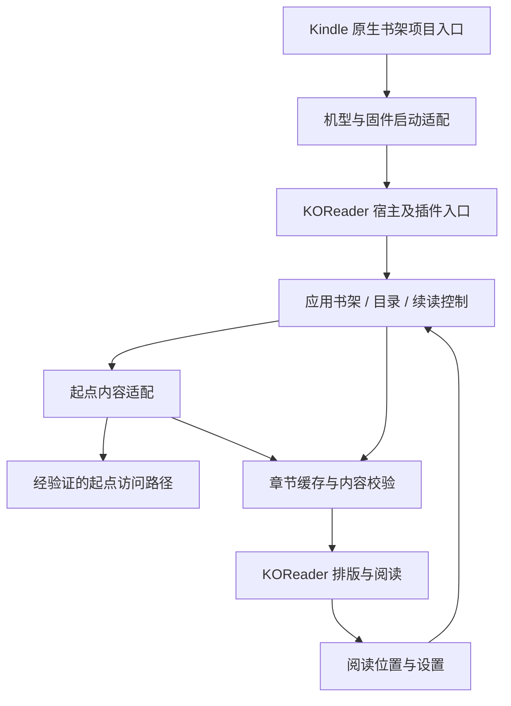

# Kindle 起点阅读：需求与技术设计

- 日期：2026-10-27
- 状态：设计初稿；技术路线为建议，未获用户确认，未进行产品实现。
- 项目：`kindle-read`
- 配套文档：[可行性验证](../../feasibility.md) · [里程碑与验收](../../roadmap.md)

## 1. 项目意图

让已越狱 Kindle 可以方便地阅读起点小说。用户看到的效果应当像原生书架里有一个应用：点击「起点阅读」，即可进入阅读流程，不需要每次连接电脑、转换文件或逐层寻找插件菜单。

项目的价值在于把“找到小说、继续阅读、查看更新”变成适合墨水屏的短流程，同时保留 Kindle 的分页、中文排版和休眠续读体验。

### 1.1 已明确的需求

| 编号 | 用户要求 | 成功的含义 |
| --- | --- | --- |
| U1 | 面向越狱版 Kindle | 应用在真实越狱 Kindle 上运行；电脑演示只能辅助开发 |
| U2 | 能阅读起点小说 | 使用真实的起点内容路径完成阅读；仅能打开本地 TXT/EPUB 不足以证明 |
| U3 | 像书架中的 app，点开就能看 | 原生书架存在项目入口；点击后直达项目界面或续读正文 |
| U4 | 先做项目文档 | 本阶段交付需求、技术选择依据、验证计划和验收标准 |

这里将“书架”解释为 Kindle 原生书架，而非 KOReader 文件列表。这是对用户意图的解释，后续若有纠正应同步修改 U3。

用户已补充设备信息：**KPW5（Kindle Paperwhite 5），已安装 KUAL**。这是用户提供的设备现状，尚未实机检查；不据此推断完整固件版本、KUAL 版本、KOReader 已安装或项目专属书架入口可用。

### 1.2 初稿采用的默认建议

以下均为作者建议，不代表用户已作选择。

- 第一轮以用户的 KPW5 为验证设备，补齐其完整固件版本后固定测试组合，再决定扩展范围。
- 首次打开进入应用内书架；再次打开优先续读最近一本书的最近位置，并提供返回书架入口。
- 优先设备直连，第一版不要求用户另行维护电脑、手机常驻程序或服务器。
- 优先评估 KOReader 插件，使用 Lua 及宿主已提供的排版、网络和界面能力；具体版本由实机验证后锁定。
- 起点免费章节先用于验证整条链路。登录和已购章节是独立的关键验证项，不因为未完成而默认从用户目标中删除。
- 界面为简体中文；墨水屏优先，分页导航，不依赖动画或连续滚动。
- 暂不包含起点站内购买流程。需要购买时由用户在官方渠道完成，项目不自动订阅或扣费。

### 1.3 待确认的信息

| 信息 | 影响 | 当前处理 |
| --- | --- | --- |
| 完整固件版本 | 启动机制、运行时架构、可用 KOReader 包 | 型号已确认为 KPW5；固件仍是实机验证前置条件，尚无通过测试的支持组合 |
| 越狱方式、KUAL 版本及 KOReader 安装状态 | 安装路径、已有依赖、入口适配 | KUAL 已安装；其版本和 KOReader 状态待检查，避免覆盖已有工具及设置 |
| 首版是否必须支持已购 VIP 章节 | 内容访问门槛、登录流程、发布范围 | 保留为独立发布条件；仅免费内容可用时必须明确标注限制 |
| 是否接受已有 KOReader 依赖 | 插件方案是否符合用户预期 | 当前为推荐方案，尚未确定 |

## 2. 范围与优先级

### 2.1 必须保留的体验

1. **入口**：系统书架有可辨识的项目项，单击直接进入项目；KUAL 菜单仅用于安装检查、调试或故障恢复。
2. **找书**：第一版支持通过起点书籍链接或书籍 ID 添加作品，显示书名、作者和目录。站内关键词搜索可后续增加。
3. **阅读**：目录选章、上一页/下一页、上一章/下一章、字号与行距设置；已缓存内容可离线阅读。
4. **续读**：保存书籍、章节及章节内位置；退出、休眠和正常重启后可恢复。
5. **更新**：用户主动检查目录更新；在内容访问方式允许时，按需加载与少量预取后续章节。
6. **可恢复**：网络断开、登录过期、权限不足、缓存损坏时保留当前位置，给出明确的下一步操作。
7. **可安装与卸载**：提供按已验证机型编写的说明，保留用户已有 KOReader 和书籍，能够移除项目入口及插件。

### 2.2 分阶段能力

| 优先级 | 能力 | 说明 |
| --- | --- | --- |
| P0 | 原生入口直达项目、真实起点章节、基础阅读与续读 | 核心闭环，必须通过实机验证 |
| P0 验证项 | 登录后已购章节访问 | 发布是否必需取决于用户目标；可行性必须尽早查明 |
| P1 | 应用内多书管理、目录更新、缓存管理、阅读设置 | 面向日常使用的首版范围 |
| P2 | 关键词搜索、起点账号书架同步、多设备进度同步 | 不承诺已有接口；需分别验证平台支持 |
| 暂不做 | 评论、打赏、榜单、推荐流、有声书、漫画、站内支付 | 不影响核心阅读目标 |

### 2.3 明确不算成功的结果

- 安装包存在但没有在真实 Kindle 上启动。
- 原生书架入口只打开 KUAL 菜单或 KOReader 通用文件管理器，还需要用户继续找插件。
- 每次阅读都要求手动下载、转换和传输文件。
- 用模拟章节、第三方小说站内容或本地导入证明“已支持起点”。
- 免费章节可读就宣称所有 VIP、订阅和账号功能可用。
- 用持续后台联网或阻止休眠来维持阅读进度。

## 3. 典型使用流程

### 3.1 首次使用

1. 用户按目标设备说明安装必要依赖及项目包。
2. Kindle 原生书架出现「起点阅读」项目项。
3. 点击项目项，进入应用内空书架，看到「添加起点书籍」和简短说明。
4. 输入书籍链接或 ID；应用在联网后查询书籍信息和目录。
5. 点击可阅读章节，进入正文。权限受限章节显示对应状态，不把错误页当作正文。

安装过程中允许一次性配置依赖，但日常阅读应遵守单击入口的要求。书架显示是否依赖系统注册、索引或筛选条件，必须写入目标机型验证记录。

### 3.2 日常续读

1. 从原生书架点击项目入口。
2. 有有效阅读记录时直接显示最近位置；无记录时显示应用内书架。
3. 默认优先使用缓存，联网检查不阻塞已有正文。
4. 用户可打开目录、回应用书架或退出到 Kindle。
5. 离开正文、切章、进入休眠或退出时保存位置；异常终止的丢失范围见验收指标。

### 3.3 登录与已购章节

登录方式尚未确定，不能预先承诺扫码登录、手机授权或 Cookie 导入可用。

- 若存在可用且允许第三方使用的授权方式，优先使用；按真实能力设计登录与会话续期。
- 若只能在官方网页完成交互，验证 Kindle 浏览器是否支持所需 JavaScript、验证流程和章节渲染。
- 在手机完成购买或登录，不等于 Kindle 插件自动获得会话和正文访问权限；必须验证会话承接方式。
- 成功登录后仍逐章检查访问结果，区分已购、未购、试读、内容下架和平台限制。
- 无可用访问路径时记录阻塞，不用其他来源补齐起点正文。若要发布免费章节版本，需明确缩小范围。

### 3.4 异常状态

| 状态 | 用户能看到什么 | 处理原则 |
| --- | --- | --- |
| 未联网 | 已缓存的正文，及「联网后加载本章」 | 不清空正文或进度，不自动反复联网 |
| 登录过期 | 「登录已过期」及可用的重新登录入口 | 不循环重试，不误报为作品不存在 |
| 章节未购买 | 「此章节需要在官方渠道购买」 | 不触发购买，不展示截断内容为完整正文 |
| 内容获取方式变更 | 「暂时无法加载」，可重试或继续缓存阅读 | 保留数据，记录无敏感信息的错误类别 |
| 空间不足 | 缓存空间提示及清理入口 | 不删除书架和进度；不把写了一半的文件当成成功缓存 |
| 启动依赖缺失 | 显示缺失组件或返回系统的提示 | 保证 Kindle 系统仍可操作；不反复重启宿主 |

## 4. 技术方案比较

| 方案 | 组成 | 优点 | 主要代价与未知项 | 当前判断 |
| --- | --- | --- | --- | --- |
| A：KOReader 插件 | 书架启动适配 + Lua 插件 + 内容适配 | 复用中文排版、分页、字体、墨水屏和休眠处理；上游已有插件机制 | 依赖宿主；从原生入口直接进入指定插件仍需验证；起点访问独立验证 | **推荐先验证，未最终选定** |
| B：独立原生阅读器 | 启动适配 + 独立 UI、排版及设备管理 | 交互和进程完全由项目控制 | 需要处理中文排版、刷新、输入、休眠、ABI 与打包；仍不能绕过入口和内容访问难题 | A 的宿主限制无法解决时再评估 |
| C：官方网页入口 | 书架启动适配 + 浏览器打开起点页面 | 更接近官方登录及页面流程，有机会减少正文适配 | Kindle 浏览器兼容性不确定，页面脚本和交互不适合墨水屏；缓存、续读和离线能力受限 | 对照验证，不默认作为主方案 |

不优先采用常驻中转服务器：会引入额外安装、运行成本和会话保管，也不自动解决平台访问限制。如直接访问失败，先说明具体阻塞，再决定是否扩大部署范围。

### 4.1 选择门槛

- A 必须证明“原生书架 → 指定插件界面/最近正文”的完整链路；只能启动 KOReader 本身不够。
- A 的真实章节路径必须独立证明，插件和排版能力不能推导出起点接入可用。
- 若 A 失败，记录失败属于入口、宿主生命周期还是内容来源，再决定 B 或 C 是否能解决；不因为失败就自动更换方案。
- 若目标固件没有可用的原生书架入口，本轮 U3 未实现。需讨论可接受的调整，不能把多级菜单当成原需求完成。

## 5. 建议架构

以下是针对方案 A 的设计边界，不代表已存在这些组件或接口。

### 5.1 组件职责

| 组件 | 职责 | 验证重点 |
| --- | --- | --- |
| 启动适配 | 注册/安装书架入口；启动宿主；传递一次性启动意图；退出恢复系统 | 原生入口可见且可点击；重复点击不产生重复阅读进程；可撤销安装 |
| 插件入口 | 识别项目启动意图，进入书架或续读；普通 KOReader 启动维持原有入口行为 | 上游是否有适用扩展点；没有现成扩展点时先评估最小改动范围 |
| 应用界面 | 本地书架、目录、添加书籍、阅读设置和明确的错误提示 | 触控区域、物理按键、分页列表、灰度可读性 |
| 内容适配 | 把实际数据访问方式转换为统一书籍、目录和章节结果 | 不把登录页、验证码、试读片段或结构变化当成完整正文 |
| 缓存 | 保存成功获取且允许缓存的章节；校验版本；控制空间；失败恢复 | 临时写入后原子替换；中断不污染旧内容 |
| 阅读桥接 | 将章节交给 KOReader 支持的格式，维护跨章导航和稳定位置 | 不暴露中间文件管理器；更新书籍不重置进度 |
| 会话管理 | 管理经过验证的登录状态及过期处理 | 不记录凭据、不把账号相关数据共享给其他会话 |

不得把启动脚本假装成普通 EPUB 并假定 Kindle 会执行它。候选 Booklet/KOL 等方案需要独立验证。不得假设 KOReader 已提供“打开某插件”的命令行参数；启动分发是待验证能力。

### 5.2 内容适配契约

这些是项目内部的概念接口，不是声称起点提供的公开 API。

| 操作 | 输入 | 结果 |
| --- | --- | --- |
| 获取能力 | 当前访问方式/会话 | 是否支持免费正文、登录、已购正文、缓存、书架同步等 |
| 获取书籍 | 经校验的起点 URL 或书籍 ID | 书名、作者、稳定来源标识、来源链接 |
| 获取目录 | 来源书籍 ID、已知目录版本 | 有序章节列表；可见的权限信息；更新时间或本地获取时间 |
| 获取章节 | 书籍 ID、章节 ID、当前会话 | 完整性已检查的正文与版本，或明确的失败状态 |

统一失败类别至少区分：离线/超时、需要登录、需要购买、来源不支持、访问挑战、频率限制、内容不存在、结构解析失败。缺少公开接口并不自动证明项目不可行，但也不能凭空编造接口地址。

起点书籍链接只用于识别作品；拒绝任意域名和本地文件路径。跨域重定向需要按已验证来源处理，不能携带会话凭据跳转至未知站点。

### 5.3 内容与位置存储

初稿建议使用 UTF-8 的版本化结构化元数据及独立章节文件；具体持久化库由实现阶段按宿主能力选择，不预先引入新数据库依赖。

| 数据 | 最小字段/语义 |
| --- | --- |
| 书架项 | 来源、书籍 ID、书名、作者、加入时间、最近打开时间、来源链接 |
| 目录项 | 章节 ID、标题、顺序、可用权限状态、目录版本 |
| 章节缓存 | 来源/账号作用域、书籍 ID、章节 ID、内容版本/校验值、获取时间、缓存许可状态 |
| 阅读位置 | 书籍 ID、章节 ID、内容版本、稳定段落锚点或宿主位置、更新时间 |
| 设置 | 字号、行距、边距、全刷偏好、缓存上限、启动时是否续读 |

位置不能只保存页码：字号、屏幕尺寸和内容变化都会改变分页。候选做法是“稳定章节 ID + 段落锚点 + 章节内偏移”；若正文版本变化无法精确恢复，则回退至最近可定位段落并说明，最差回到该章开头。需要验证与宿主位置表示的转换。

首轮比较单章 HTML 与增量 EPUB 的阅读桥接成本，选择能支持连续阅读且不破坏进度的一种；不默认每次更新就重建整本小说。尚未选择格式，不影响本阶段需求文档。

### 5.4 缓存、联网与会话

- 前台按需获取，初始建议预取接下来的 2 章；默认不在休眠时联网，不做无人值守全书下载。
- 请求数、超时、重试及退避应受控；访问挑战、权限错误不做自动重试，限流响应尊重服务端等待要求。
- 建议初始缓存上限为 100 MiB，可调整；清理最久未读内容时保护当前章节和阅读记录。参数为待实测默认值。
- 每章先写临时文件，完成正文检查及校验后再更新索引。目录变化不能删除正在阅读的有效缓存。
- 已购正文只有在经验证的访问方式允许获取及缓存时才纳入缓存范围；无法支持离线时明确显示能力限制。
- 账号切换隔离私有缓存；退出账号清理其会话与私有正文，保留不含凭据的本地进度时应向用户说明。
- 默认不长期存储登录会话，设备重启后可要求重新登录。若要支持持久登录，须先验证目标系统的受保护存储；`/mnt/us` 是 USB 可见存储，不能把设置 `chmod 600` 当作可靠保护。不得在代码、示例配置或日志中写入真实密码、Cookie 或 Token。
- 正文数据与项目设置可以考虑放在项目专属可写目录；最终路径、文件系统及卸载范围必须在实机验证后记录。项目不能覆盖已有 KOReader 设置或系统数据库。

### 5.5 设备生命周期与安装

- 优先使用目标版本 KOReader 已有的输入、刷新、休眠、恢复和退出逻辑，避免重复管理系统服务。
- 处理启动中再次点击、已有 KOReader 正在运行、USB 存储模式、低电量、休眠唤醒、无 Wi-Fi 与宿主更新。
- 若使用一次性启动标记，需限制有效期、成功消费后清理，并避免普通 KOReader 启动误入本项目。具体机制先做验证。
- 安装前检查机型、固件和依赖版本；不支持的组合应拒绝安装并说明原因。
- 项目代码、启动适配与用户数据分开；卸载可选择保留阅读记录；必须验证安装失败时的恢复路径。
- 分发 KOReader 或衍生组件前核对其 AGPL-3.0 许可及相关分发要求。项目自身许可证尚未确定，不在文档阶段默认添加许可证或复制上游实现。

## 6. 性能与质量目标

以下都是建议验收目标，不是实测结果。需要在确定的目标机型上记录固件、宿主版本、内容规模与测试条件。

| 项目 | 建议目标 | 测量方式 |
| --- | --- | --- |
| 缓存续读冷启动 | 10 次中至少 9 次在 10 秒内显示可读正文 | 宿主未运行，从点击书架项目到正文可读，记录全部耗时 |
| 已缓存页面翻页 | 30 次普通翻页的 P95 不超过 1 秒 | 固定小说和字号，排除主动全刷并单独记录全刷耗时 |
| 正常续读 | 正常退出/休眠后恢复到相同段落 | 改字号前后各验证一轮 |
| 异常中止恢复 | 最多丢失最近 1 页位置 | 翻页位置先更新内存并及时持久化；随机中止后校验，不只测正常退出 |
| 长目录 | 1,000 章的本地目录能分段打开与翻页 | 测试夹具只验证目录性能，不作为起点接入证据 |
| 休眠 | 不因本项目持续联网或阻止设备睡眠 | 对比未启用项目时的宿主行为，观察休眠期请求及唤醒记录 |

若目标设备达不到建议性能值，记录测量数据并调整实现或发布指标；不能只改指标后声称性能问题已经解决。

## 7. 开发边界与待办决策

本阶段只编写项目文档。仓库此前只有 README；没有可以沿用的业务代码、依赖清单、测试框架或运行服务。

开始实现前先完成 [P0 可行性验证](../../feasibility.md)，并据结果确认方案与发布范围。以下决定留给后续实现者在已确认范围内选择：模块命名、元数据序列化库、内部错误表示、测试工具、打包脚本组织、界面控件细节。

以下决定不能默默替用户更换：取消原生书架入口、要求新增常驻服务器、仅支持第三方内容来源、删除用户需要的已购章节能力、把每日使用流程变成手动转换和传输文件。

当前设计中最重要的未知项是 KPW5 的完整固件版本、已有运行环境及可用内容访问路径，而不是界面配色或编程语言。验证结果应先写回文档，再进入产品实现。
